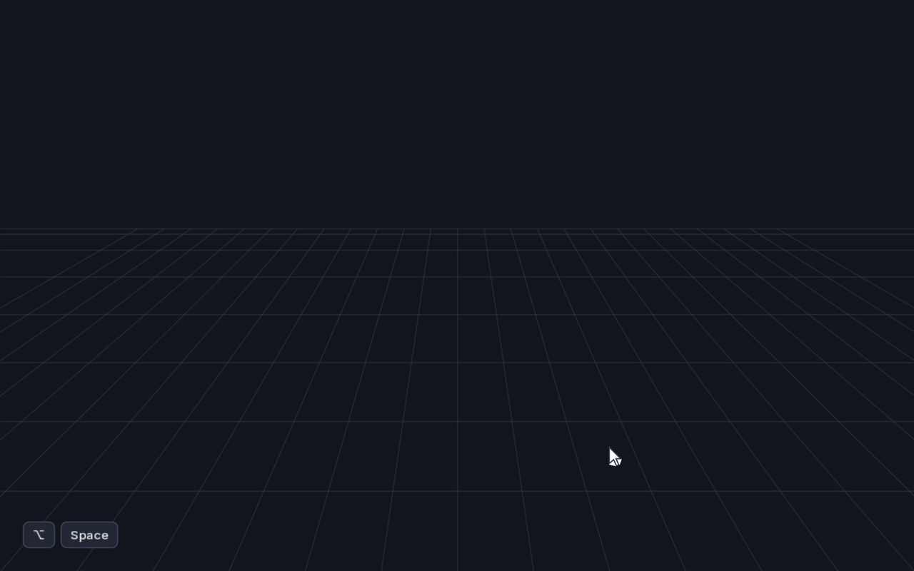

# ImGui Hotbox

A **hotbox** with **marking menus** for [Dear ImGui](https://github.com/ocornut/imgui)
applications, inspired by the hotbox in Autodesk® Maya® and drawn in the
IFCStudio UI design system. This is an independent project, not affiliated
with or endorsed by Autodesk (see [Credits and trademarks](#credits-and-trademarks)).

<p align="center">
  
  <br>
  <sub>An 18-second tour, rendered from the harness.
  <a href="docs/media/hotbox-tour.mp4">Full-resolution MP4</a></sub>
</p>

- Pure Dear ImGui widget library (C++20). It does not own your window, GPU
  device or render loop, and it has no dependency on GLFW, Dawn or WebGPU.
- Crisp at any DPI: Inter text, Lucide chrome glyphs, SVG icons rasterised
  per density, design-system shadows, Light / Dark / System themes.
- Ships with a GLFW + Dawn (WebGPU) harness to try it and to render
  deterministic screenshots.

**Status:** milestones M0–M4 are done (core model, drawing, motion, theming).
M5 is next: search, recent commands, tooltips and full keyboard navigation
are planned but not built yet.

Contents:

1. [What is a hotbox?](#what-is-a-hotbox)
2. [Using the hotbox](#using-the-hotbox)
3. [Try it in the harness](#try-it-in-the-harness)
4. [Programming interface](#programming-interface)
5. [Build and run](#build-and-run)
6. [Harness reference](#harness-reference)
7. [Repository guide](#repository-guide)
8. [Credits and trademarks](#credits-and-trademarks)
9. [License](#license)

---

## What is a hotbox?

Most applications put their commands in a menu bar at the top of the window.
In a big tool, that means a long mouse trip to the top of the screen, a
search through nested menus, and a trip back. A hotbox removes the trip.

**Hold a key and the whole menu bar appears around your mouse pointer.**
Pick a command and let go of the key, and the hotbox disappears. You never
leave the spot you were working on.

A hotbox has two halves:

1. **Menu rows.** Your application's menus, laid out as floating strips
   centred on the pointer. You click a menu title and choose an item, just
   like a normal menu bar. This half is for finding commands.
2. **Marking menus.** The space around the rows is split into five
   invisible **zones**: North, East, South, West and Center. Pressing a mouse
   button in a zone and dragging in a direction picks a command. Each zone
   has a separate marking menu for each mouse button (left, middle, right),
   so there are 15 of them. This half is for speed.

Marking menus are what make the hotbox fast. Each one has up to eight
commands placed on compass directions (N, NE, E, … NW). Only the
**direction** of your drag counts, not its length, so after a little practice
"press in the North zone, flick up and to the right" becomes muscle memory,
like a keyboard shortcut you draw. Experts flick so fast that the menu never
appears at all. That is called **mark-ahead**.

```
                 ╲                                           ╱        ← zone ticks
            ( File  Edit  Create  Select  Modify  Display  Windows  Cache │ Help )
                     ( View  Shading  Lighting  Show  Renderer  Panels )
          ( Recent Commands )      ( Modeling )      ( Hotbox Controls )     ← centre row
   ( Mesh  Edit Mesh  Mesh Tools  Mesh Display │ Curves  Surfaces  Deform  UV  Generate )
                ( Skeleton  Skin  Deform  Constrain  Control )
                 ╱                                           ╲

                                   North
                         ╲                   ╱
                           ╲               ╱
                  West       (  Center  )       East
                           ╱               ╲
                         ╱                   ╲
                                   South
```

The four outer zones are separated by the two diagonals through the point
where the hotbox opened, and they extend to the edges of the screen, so they
are impossible to miss. The short diagonal **zone ticks** above and below
the rows are the only visible hint of those boundaries. The Center zone is a
circle with a 36 pt radius around the opening point.

---

## Using the hotbox

### Open and close

| To | Do this |
|---|---|
| Open | **Hold ⌥ Space** on macOS or **Alt+Space** on Windows and Linux. The hotbox opens centred on the pointer after 180 ms, or immediately if you move the mouse. |
| Keep it open | Keep holding **Space**. You can let go of ⌥ / Alt once it is open. |
| Close | Release **Space**. |
| Invoke from a menu | Release **Space** while the pointer is over a menu item ("release to invoke"), or click the item. |
| Cancel | Press **Esc**, or click empty space that has no marking menu. |
| Pin it open | Press **P** while holding the trigger, or choose **Hotbox Controls → Pin Hotbox**. A pinned hotbox stays open after you release Space and after a command runs. Close it with Esc or a click outside. |

A **quick tap** of the trigger (shorter than 180 ms, without moving the
mouse) does not open the hotbox. The application receives it as a separate
"tap" action, for example to maximise the viewport.

The hotbox never opens while a text field has keyboard focus, so the chord
still reaches your text fields there.

### Menu rows

- **Above the centre row:** the common menus (File, Edit, …) and the panel
  menus (View, Shading, Lighting, Show, Renderer, Panels).
- **Centre row:**
  - **Recent Commands** on the left (not active yet: recents arrive in M5).
  - The **menu-set button** in the middle shows the active menu set (here
    "Modeling") in the accent colour. Click it to switch sets.
  - **Hotbox Controls** on the right: Pin Hotbox, and switches for Menu Rows
    and Zone Ticks.
- **Below the centre row:** the menus of the active **menu set**. A menu set
  is a group of task-specific menus. In the demo, "Modeling" shows the
  mesh tools and "Rigging" shows skeleton and skin tools. Switching sets changes
  the rows below the centre, and nothing else.

Click a title to open its dropdown. Dropdowns show icons, check marks,
shortcut hints, separators, section headers and cascading submenus. Hover a
submenu row to open it.

Some items have an **option box**, a small square at the right edge of the
row. Clicking the square runs the item's "options" variant instead (typically
it opens the command's settings before running it). Holding
Shift while you release Space over the row does the same.

Disabled items are drawn in the disabled text colour and give a short
shake if you try to use them.

### Marking menus

1. With the hotbox open, **press** a mouse button anywhere in a zone that is
   not on a menu title. Which zone you press in, and which button you use,
   picks the marking menu.
2. **Drag** towards the command you want. The item in that direction lights
   up. A thin "rubber band" line runs from the press point to the pointer.
3. **Release** the button to run it.

Details:

- Only the angle matters once you are 12 pt from the press point. Releasing
  inside that small dead zone cancels.
- **Click instead of drag:** a quick click without moving keeps the marking
  menu open. Click an item to choose it. This is handy on a trackpad.
- **Number keys** `1`–`8` pick items while a marking menu is shown, starting
  at North and going clockwise.
- **Hold Shift** when you release to use the item's option box.
- **Submenus:** an item can open a nested marking menu. Pause on it for
  about 280 ms, or turn sharply (more than 50°) after dragging at least
  40 pt. Strokes like "East, then North" can go up to three levels deep.
- **More than eight items:** extras appear in an overflow list below the
  South item.
- **Center zone:** a short left-click on the menu-set button opens the
  menu-set chooser. A left-drag that starts on it uses the Center marking
  menu. Middle and right buttons always use the Center marking menu.

### Mark-ahead (expert mode)

The marking menu waits 120 ms before it draws. If you press, flick and
release within 350 ms, the command runs **without the menu ever appearing**.
You see only the ink of your stroke and a short confirmation toast with the
command's name. With practice, a whole command becomes
"⌥Space + flick", which is faster than any menu and needs no memorised
key combinations.

### Tips for learning

- Start with the menu rows. They work like a normal menu bar.
- Learn the marking menus of one zone and one button at a time. The
  application usually puts related commands in the same zone (for example
  view commands in the North zone).
- Say the stroke to yourself ("North, up-right") the first few times.
- Once you know where a command lives, stop looking and just flick.

### Known limitations

- **⌥Space is taken on some Macs.** Launchers such as ChatGPT, Raycast or
  Alfred often register ⌥Space as a global hotkey, and the hotbox then never
  sees it. Change the other app's shortcut, change `Config::trigger`, or use
  the harness's **Open Hotbox** button. Some Linux window managers (GNOME)
  reserve Alt+Space for their window menu.
- Search, recent commands, tooltips (including `disabled_reason`) and
  Tab/arrow-key navigation arrive in M5.
- Only the Solid material is available. Frost needs a blurred backdrop from
  the renderer and is a later add-on.

---

## Try it in the harness

Build it (see [Build and run](#build-and-run)) and start
`build/macos-debug/hotbox_harness`. The **Hotbox harness** panel has an
**Open Hotbox** button that opens the hotbox at the centre of the window. A
hotbox opened this way stays open until you press Esc or click outside it.
Alternatively, hold ⌥Space / Alt+Space over the viewport. The last command
you ran is shown under the button.

The demo registers the menus of a fictional 3D application and these
marking menus:

| Zone | Left button | Middle button | Right button |
|---|---|---|---|
| North | N Frame · NE Isometric · E Top · SE Front · S Right · SW Projection (disabled) · W Edges · NW Render SVG | S Top | N Perspective · E Cameras ▸ (submenu) |
| East | E Extrude · NE Bevel | W Separate | E Combine |
| South | S Polygon Cube · SE Polygon Sphere | N Invert Selection | S Select All |
| West | W Duplicate · NW Undo · overflow: Snap to Grid, Delete History (disabled) | E Show All | W Hide Selection |
| Center | N Outliner · E Attribute Editor | N Freeze Transformations | S Center Pivot |

Things to try:

- **Edit** menu: a toggle (Snap to Grid), an option box (Duplicate
  Special…), a disabled item (Delete History) and shortcut hints.
- **View → Cameras → Additional Cameras**: nested submenus.
- Menu-set button: switch between **Modeling** and **Rigging**.
- Left-press in the North zone and flick up-right quickly: mark-ahead runs
  Isometric without showing the menu.
- The panel's **Theme**, **Shape**, **Motion speed**, **Reduced motion** and
  **0.1× slow motion** controls. The harness starts in System theme. The
  **Contrast** table shows the lowest contrast ratio of each colour role.

---

## Programming interface

All public types are in namespace `hotbox`. Include the umbrella header:

```cpp
#include <hotbox/hotbox.hpp>
```

Requirements: C++20, CMake ≥ 3.24 and Dear ImGui **1.92 or newer** (the
vendored copy is `v1.92.9b-docking`). The library uses ImGui 1.92's dynamic
fonts, so it needs a renderer backend that supports
`ImGuiBackendFlags_RendererHasTextures`.

### Quick start

```cpp
#include <hotbox/hotbox.hpp>

// 1. Once, after ImGui::CreateContext() and before the first frame.
auto faces = hotbox::fonts::load_embedded(*ImGui::GetIO().Fonts);
ImGui::GetIO().FontDefault = faces.regular;   // optional: use Inter for your UI too

// 2. Register commands, then place them in menus and marking menus.
hotbox::Registry registry;
std::vector<hotbox::ItemHandle> items;
items.push_back(registry.add({.id = "edit.undo", .label = "Undo", .shortcut = "Ctrl+Z",
    .on_invoke = [&](const hotbox::InvokeContext&) { app.undo(); }}));
items.push_back(registry.add({.id = "edit.redo", .label = "Redo", .shortcut = "Ctrl+Shift+Z",
    .on_invoke = [&](const hotbox::InvokeContext&) { app.redo(); }}));

registry.menu("edit", "Edit").item("edit.undo").item("edit.redo");
registry.marking_menu(hotbox::Zone::West)
    .set(hotbox::Dir::W, "edit.undo")
    .set(hotbox::Dir::E, "edit.redo");

// 3. Create the widget. The registry must outlive it.
hotbox::Hotbox widget(registry);
widget.set_theme_mode(hotbox::ThemeMode::System);

// 4. Every frame.
ImGui::NewFrame();
hotbox::begin_frame();   // advances the hotbox animations
draw_my_ui();
widget.frame();          // after your own UI, before Render()
ImGui::Render();
```

That is a complete integration. Hold ⌥Space / Alt+Space, then left-drag
left in the West zone to undo.

### Concepts

The API separates **what a command is** from **where it appears**.

| Concept | API | Purpose |
|---|---|---|
| Command (item) | `Registry::add(ItemDesc)` | A command's id, label, icon, callbacks and state. |
| Menu | `Registry::menu(id, label)` | An ordered list of item ids, separators, headers and submenus. Shown as a title in a row. |
| Menu set | `Registry::define_menu_set(id, menus)` | A named group of menus shown below the centre row. One set is active. |
| Marking menu | `Registry::marking_menu(zone, button)` | Up to eight item ids on compass directions, plus an overflow list. |

The same command can appear in any number of menus and marking menus.
Menu ids and item ids are separate namespaces, so a menu called `edit` and
an item called `edit` do not clash.

### Commands: `ItemDesc`

```cpp
hotbox::ItemDesc desc{
    .id = "edit.duplicate",                     // required, unique, stable
    .label = "Duplicate",
    .alt_text = "Duplicate the selected objects",
    .disabled_reason = "Select one or more objects first",
    .icon = hotbox::Icon::svg_file("icons/duplicate.svg"),
    .shortcut = "Ctrl+D",                       // display only
    .keywords = {"copy", "clone"},
    .on_invoke = [&](const hotbox::InvokeContext&) { scene.duplicate(); },
    .on_option = [&](const hotbox::InvokeContext&) { ui.open_duplicate_options(); },
    .is_enabled = [&] { return !scene.selection().empty(); },
};
auto handle = registry.add(std::move(desc));
```

Designated initialisers must follow the declaration order shown in this table.

| Field | Meaning |
|---|---|
| `id` | **Required.** Unique, stable id such as `"edit.duplicate"`. `add()` logs and returns an empty handle for a duplicate. |
| `label` | Text shown in rows and menus. May be empty for an icon-only item. |
| `alt_text` | Required when `label` is empty. Used as the fallback label and the monogram source; reserved for tooltips, search and accessibility. |
| `tooltip` | Longer description (`**bold**`, `` `code` ``). Stored for M5; not drawn yet. |
| `disabled_reason` | Why the item is disabled. Stored for M5 tooltips; not drawn yet. |
| `icon` | See [Icons](#icons). Default `Icon::none()`. |
| `shortcut` | Shortcut hint drawn at the right of menu rows. It does **not** bind a key. |
| `keywords` | Extra search terms (for M5 search). |
| `kind` | `Action` (default), `Toggle`, `Radio`, `Submenu`, `Separator` or `Header`. |
| `radio_group` | Group name for `Radio` items. The host decides which one is checked. |
| `on_invoke` | Runs when the command is chosen. |
| `on_option` | Enables the option box and runs when it is used. |
| `is_enabled` | Polled while visible. Default: always enabled. |
| `is_checked` | Polled for `Toggle` and `Radio` items to draw the check mark. |
| `is_visible` | Hidden items are left out of menus and marking menus. Default: visible. |
| `user_data` | Passed back in `InvokeContext::user_data`. |

Predicates are called every frame while the hotbox is open, so keep them
cheap. Exceptions thrown from predicates and callbacks are caught and logged
with the command id.

### Registry

```cpp
hotbox::ItemHandle handle = registry.add(desc);   // [[nodiscard]]
registry.update("edit.duplicate", [](hotbox::ItemDesc& item) { item.label = "Duplicate…"; });
const hotbox::ItemDesc* found = registry.find("edit.duplicate");
registry.remove("edit.duplicate");
```

- **`ItemHandle`** is RAII: destroying it unregisters that exact
  registration. It may safely outlive the registry. Call `release()` to keep
  the item registered for the registry's lifetime, which is handy for static
  commands.
- The registry is **main-thread only**. Changes made during a frame (for
  example from a callback) become visible at the start of the next frame.
- Menus and marking menus refer to items by id. An id that is not registered,
  or whose item is hidden, is simply skipped. You can build the menus first
  and register commands later, for example when a plugin loads.

### Menus and menu sets

```cpp
registry.menu("edit", "Edit")
    .item("edit.undo").item("edit.redo")
    .separator()
    .header("Duplicate")
    .item("edit.duplicate")
    .submenu("edit.group", "Group", [](hotbox::MenuBuilder& m) {
        m.item("edit.group.make").item("edit.group.ungroup");
    });

registry.define_menu_set("Modeling", {"mesh", "edit-mesh", "mesh-tools"});
registry.define_menu_set("Rigging", {"skeleton", "skin", "constrain"});
registry.set_active_menu_set("Modeling");
```

Calling `menu()` again with an existing id appends to that menu. Rows are
filled like this:

| Row | Menus |
|---|---|
| Top rows | Every top-level menu that is not in any menu set, in registration order. The panel menus `view`, `shading`, `lighting`, `show`, `renderer` and `panels` get a row of their own under the common menus. |
| Centre row | Recent Commands, the menu-set button (labelled with the active set), Hotbox Controls. |
| Rows below | The active menu set's menus, in the order given, wrapped at about 700 pt per row. |

The menu-set button lists every set in definition order and lets the user
switch.

### Marking menus

```cpp
using hotbox::Dir;
registry.marking_menu(hotbox::Zone::North)                 // left button by default
    .set(Dir::N, "view.frame").set(Dir::E, "view.top").set(Dir::W, "view.side");

registry.marking_menu(hotbox::Zone::North, ImGuiMouseButton_Right)
    .set(Dir::E, "view.cameras")                           // a menu id: opens as a submenu
    .overflow({"view.back", "view.bottom"});               // listed below the South item
```

- 5 zones (`North`, `East`, `South`, `West`, `Center`) × 3 buttons
  (`ImGuiMouseButton_Left`, `_Middle`, `_Right`) = 15 independent slots.
  Each can be empty.
- Directions are `N, NE, E, SE, S, SW, W, NW`. Keyboard indices 1–8 follow
  the same clockwise order.
- A direction that names a **menu id** (or an item of kind `Submenu`) opens
  that menu as a nested marking menu.
- Leave room for growth: users learn positions, so moving a command to a
  different direction later breaks their muscle memory.

### Layout files

The whole arrangement (menus, menu sets and marking menus, but not the
commands themselves) can be saved and loaded as a line-based text format,
which is easy to diff and to hand-edit:

```cpp
std::string text = registry.save_layout();
registry.load_layout(text);   // throws std::invalid_argument; the old layout is kept on error
```

```text
# Comments start with #. Quote labels that contain spaces.
menu edit "Edit"
  item edit.undo
  item edit.redo
  separator
  header "Duplicate"
  item edit.duplicate
  submenu edit.group "Group"
    item edit.group.make
  end
menu mesh "Mesh"
  item mesh.combine
menu-set Modeling mesh edit-mesh mesh-tools
menu-set Rigging skeleton skin
active-menu-set Modeling
marking north left
  N view.frame
  E view.top
  overflow view.back view.bottom
marking center right
  S modify.center
```

| Line | Meaning |
|---|---|
| `menu <id> "<label>"` | Start a top-level menu. |
| `submenu <id> "<label>"` … `end` | A nested menu inside the current one. |
| `item <id>` / `separator` / `header "<text>"` | Menu entries. |
| `submenu-ref <id>` | Reuse a menu defined elsewhere as a submenu. |
| `menu-set <id> <menu ids…>` | Define a menu set. |
| `active-menu-set <id>` | Select the active set. |
| `marking <zone> <button>` | Start a marking-menu slot: zone `north|east|south|west|center`, button `left|middle|right`. |
| `<DIR> <id>` | Assign a direction (`N` … `NW`) in the current slot. |
| `overflow <ids…>` | Overflow list of the current slot. |

A layout loaded from text has no menu icons. Commands still have to be
registered in code with `Registry::add`.

### Icons

```cpp
hotbox::Icon::none();
hotbox::Icon::glyph(lucide_codepoint);           // codepoint in the bundled Lucide font
hotbox::Icon::glyph(codepoint, my_font);         // codepoint in your own ImFont
hotbox::Icon::svg(svg_text);                     // rasterised per DPI and cached
hotbox::Icon::svg_file("icons/cube.svg");
hotbox::Icon::svg_pair(regular_32, compact_16);  // two optical masters
hotbox::Icon::texture(tex_ref, {16, 16});        // your own texture, size in pt
hotbox::Icon::monogram("PC");                    // 1–2 letters in a rounded square
```

- Monochrome glyphs and SVGs are tinted with the current text colour, so
  they follow the theme. Call `.tintable(false)` for colour artwork, or
  `.color(IM_COL32(...))` for a fixed colour.
- `svg_pair` uses the 16 px compact master below 24 pt and the 32 px regular
  master above, independent of screen density. SVGs are rendered with
  lunasvg at the device resolution and packed into the ImGui font atlas, so
  they are never scaled bitmaps and need no renderer integration.
- Disabled items draw SVG icons in greyscale and colour textures at 40 %.
- With `Config::monogram_fallback` on, icon-only items without artwork get
  a monogram made from their `alt_text`.

### The widget: `Hotbox`

```cpp
hotbox::Config config;
config.trigger = ImGuiMod_Ctrl | ImGuiKey_H;      // any modifier + key chord
config.can_open = [&] { return !app.modal_open(); };
hotbox::Hotbox widget(registry, config);

widget.on_open = [] { /* … */ };
widget.on_close = [] { /* … */ };
widget.on_trigger_tap = [&] { viewport.toggle_maximised(); };
widget.on_invoked = [&](const hotbox::InvokeContext& ctx) { analytics.record(ctx.id); };

widget.open(ImGui::GetMousePos());   // open from code (a toolbar button, a gamepad…)
widget.close();                      // close(false) skips the animation
widget.set_pinned(true);
bool open = widget.is_open();
```

| Member | Purpose |
|---|---|
| `frame()` | Submit once per frame, after your UI and before `ImGui::Render()`. Handles input, draws on the foreground draw list and runs queued callbacks at the end. |
| `open(pos)` / `close(animated)` / `is_open()` | Control from code. A hotbox opened with `open()` stays open until Esc, a click outside or a command runs, because no trigger key is being held. `open()` does nothing while a text field is active or `can_open` returns false. |
| `set_pinned(bool)` | Keep the hotbox open after the trigger is released. |
| `on_open`, `on_close` | Called when it opens or closes. |
| `on_trigger_tap` | A quick tap of the trigger that did not open the hotbox. |
| `on_invoked` | Global observer for every invocation (logging, analytics, macro recording). Called in addition to the item's own callback. |
| `set_motion`, `motion_prefs`, `is_animating` | See [Motion](#motion). |
| `set_theme`, `set_theme_mode`, `set_system_appearance_provider`, `current_theme` | See [Theming](#theming). |

While the hotbox is open it sets `io.WantCaptureMouse` and
`io.WantCaptureKeyboard`, so your application should check those flags as
usual and ignore input. On macOS it also swallows the non-breaking space
that ⌥Space types.

#### `Config`

| Field | Default | Meaning |
|---|---|---|
| `trigger` | `ImGuiMod_Alt \| ImGuiKey_Space` | Chord that opens the hotbox. Registered with `ImGui::Shortcut(..., ImGuiInputFlags_RouteGlobal)`. Plain `ImGuiKey_Space` without a modifier is not supported yet and is ignored. |
| `hold_threshold_ms` | 180 | Shorter presses without pointer movement count as a tap. |
| `reveal_delay_ms` | 120 | Delay before a marking menu is drawn (mark-ahead window starts). |
| `markahead_window_ms` | 350 | A stroke released within this time fires without the menu. |
| `submenu_dwell_ms` | 280 | Dwell time that opens a marking submenu. |
| `dead_zone_pt` | 12 | Radius around the press point where nothing is selected. |
| `show_menu_rows` | true | Show the menu rows (the user can toggle this in Hotbox Controls). |
| `show_zone_ticks` | true | Show the diagonal zone ticks. |
| `enable_search` | true | Reserved for M5 search. |
| `monogram_fallback` | true | Draw monograms for icon-less, label-less items. |
| `scrim_opacity` | 0.35 | Multiplied with the theme's scrim alpha. |
| `can_open` | empty | Return `false` to veto opening. |

#### `InvokeContext`

Callbacks receive the context of the invocation:

| Field | Meaning |
|---|---|
| `id` | The command id. |
| `source` | `MarkingMenu`, `MarkAhead`, `MenuRow`, `Search`, `Keyboard`, `Recent` or `Api`. |
| `button` | Mouse button of the marking menu. |
| `modifiers` | Modifier keys at the time of invocation. |
| `invoke_pos` | Screen position where the hotbox was opened, for example to place a new object there. |
| `option_box` | `true` when the option box was used (`on_option` is called instead of `on_invoke`). |
| `user_data` | The item's `user_data`. |

Callbacks never run in the middle of drawing. They are queued and run at the
end of `frame()`, after the close animation has started, so a callback may
open a modal, change the registry or destroy items.

### Theming

```cpp
auto light = hotbox::Theme::IFCStudioLight();
auto dark = hotbox::Theme::IFCStudioDark();
light.shape = dark.shape = hotbox::ShapeSetting::Square;   // or Rounded (default)
widget.set_theme(light, dark);
widget.set_theme_mode(hotbox::ThemeMode::System);           // Light, Dark (default) or System

// Optional: follow your application's own appearance instead of the OS.
widget.set_system_appearance_provider([&] {
    return app.dark_ui() ? hotbox::ThemeMode::Dark : hotbox::ThemeMode::Light;
});

// Optional: style the rest of your ImGui UI with the same tokens.
hotbox::ApplyImGuiTheme(widget.current_theme(), ImGui::GetStyle());
```

- **System** mode follows the OS appearance live on macOS, Windows and Linux
  (through the desktop portal when built with GLib). A provider that returns
  `ThemeMode::System`, or an empty provider, falls back to the OS.
- Theme and shape changes animate.
- A `Theme` holds the generated design tokens (`tokens.color("surface/app")`,
  `tokens.text("type/caption")`), the hotbox colour roles (`colors`), the
  shape setting, the material and the motion timings. Edit `colors` to
  customise individual roles.
- `CheckSolidContrast(theme)` reports the lowest contrast ratio of each
  role across its painted states, useful for checking a customised theme.

### Motion

```cpp
widget.set_motion({.speed = 1.0f, .reduced_motion = false});   // speed 0.1 = slow motion, 0 = instant
if (widget.is_animating())
    request_redraw();   // for event-driven render loops
```

- Animations use [ImAnim](https://github.com/soufianekhiat/ImAnim). Call
  `hotbox::begin_frame()` once after `ImGui::NewFrame()`. If your
  application already advances ImAnim itself, call `begin_frame(true)` after
  your update instead.
- In System theme mode the widget also follows the OS "reduce motion"
  setting until you call `set_motion()`.
- If you only redraw on input, keep rendering while `is_animating()` is true.

### Fonts

The hotbox draws with **Inter** (Regular, Medium, SemiBold) and **Lucide**.
They are embedded in the library by default:

```cpp
auto faces = hotbox::fonts::load_embedded(*io.Fonts);              // HOTBOX_EMBED_FONTS=ON
auto faces = hotbox::fonts::load_from_files(*io.Fonts, vendor_dir); // HOTBOX_EMBED_FONTS=OFF
if (!faces) { /* a face failed to load */ }
```

Load them before the first frame. If the faces are missing, the hotbox falls
back to ImGui's current font and loses its chrome glyphs.

Dear ImGui sizes fonts by ascent + descent, while design tools size them by
em. `hotbox::fonts::imgui_size(font, em)` converts a design size so text
matches the design:

```cpp
ImGui::PushFont(faces.semibold, hotbox::fonts::imgui_size(faces.semibold, 13));
```

### Logging

The library logs to an spdlog logger named `"hotbox"` (open/close and
invocations at info, gesture decisions at debug, duplicate ids and missing
icons at warn). Route it into your own logging with
`hotbox::set_logger(my_logger)`; an empty pointer restores the default.
Build with `HOTBOX_WITH_SPDLOG=OFF` to drop spdlog entirely.

### Adding the library to your project

```cmake
set(HOTBOX_BUILD_HARNESS OFF CACHE BOOL "" FORCE)
set(HOTBOX_BUILD_TESTS OFF CACHE BOOL "" FORCE)
set(HOTBOX_IMGUI_TARGET my_imgui CACHE STRING "" FORCE)   # optional: your own ImGui target
add_subdirectory(third_party/imgui-hotbox)
target_link_libraries(my_app PRIVATE hotbox::hotbox)
```

| Option | Default | Effect |
|---|---|---|
| `HOTBOX_BUILD_HARNESS` | ON | Build the GLFW + Dawn harness. Off: no GLFW, Dawn or WebGPU needed. |
| `HOTBOX_BUILD_TESTS` | ON | Build `hotbox_tests` (doctest). |
| `HOTBOX_WITH_SPDLOG` | ON | Log through spdlog. |
| `HOTBOX_WITH_FREETYPE` | ON | Use ImGui's FreeType loader. Turn off if your ImGui target already compiles it, and let the host select the loader. |
| `HOTBOX_EMBED_FONTS` | ON | Embed Inter and Lucide. Off: load them with `fonts::load_from_files`. |
| `HOTBOX_IMGUI_TARGET` | vendored | Link against your existing, compatible ImGui target to avoid duplicate ImGui symbols. |
| `HOTBOX_DAWN_PREBUILT_DIR` | empty | Use a pre-built static Dawn for the harness. |

---

## Build and run

```sh
git submodule update --init -- vendor/dawn
bash scripts/vendor.sh
cmake --preset macos-debug
cmake --build --preset macos-debug
ctest --preset macos-debug
build/macos-debug/hotbox_harness
```

Use `windows-debug` in a Visual Studio developer shell or `linux-debug` on
Linux. The macOS harness uses Metal, the Windows harness D3D12, and the Linux
harness Vulkan with X11 and Wayland. On Ubuntu, install
`xorg-dev libx11-xcb-dev libwayland-dev wayland-protocols libxkbcommon-dev`,
and `libglib2.0-dev` to enable live desktop-portal appearance.

The first configure needs network access for Dawn's pinned dependencies.
The vendor script restores missing snapshots. CMake applies the
version-file patch to a copy of Dawn in the build tree.

### Library-only builds

Turn off `HOTBOX_BUILD_HARNESS` to build without GLFW or Dawn. The `asan`
and `ubsan` presets exercise this build.

### Reuse a Dawn build

Point `HOTBOX_DAWN_PREBUILT_DIR` to the install prefix of a compatible
monolithic **static** Dawn package. To install the package from the macOS
source build:

```sh
cmake --build --preset macos-debug --target webgpu_upstream_cpp_headers_gen
cmake --install build/macos-debug/vendor/dawn --prefix "$PWD/build/dawn-install"
cmake -S . -B build/prebuilt -G Ninja -DCMAKE_BUILD_TYPE=Debug \
  -DHOTBOX_DAWN_PREBUILT_DIR="$PWD/build/dawn-install"
cmake --build build/prebuilt
```

---

## Harness reference

```text
hotbox_harness [--theme dark|light|system] [--shape rounded|square]
               [--scenario NAME --scale N --time S] [--motion N]
               [--reduced-motion on|off] [--icons public|private]
               [--frames N] [--out FILE | --sequence DIR]
```

Without `--scenario` the harness opens an interactive window. With a
scenario it renders offscreen and writes a PNG at the native framebuffer
size, which makes captures repeatable:

```sh
build/macos-debug/hotbox_harness --scenario menu-edit --theme dark --scale 1.5 \
  --time 0.15 --out build/menu-edit-dark-1.5x.png
```

Save every frame of a scripted transition with `--sequence`; `--motion 0.1`
slows it down tenfold:

```sh
build/macos-debug/hotbox_harness --scenario open-close --theme light --scale 2 \
  --motion 0.1 --frames 246 --sequence build/open-close
```

| Scenario | Shows |
|---|---|
| `open-layout` | The open hotbox with all rows. |
| `menu-edit` | The Edit dropdown. |
| `submenu`, `submenu-cameras` | Cascading dropdowns (View → Cameras). |
| `marking-n2` | The North left-button marking menu. |
| `marking-invoke`, `marking-disabled` | Invoking an item, and trying a disabled one. |
| `mark-ahead` | A mark-ahead stroke with its ink and toast. |
| `open-close` | The open and close transitions. |
| `theme-shape` | An animated theme and shape change. |
| `tour` | The scripted 18-second tour at the top of this README, with a drawn pointer, key caps and captions. |

`scripts/record_tour.sh` renders the `tour` scenario and writes
`docs/media/hotbox-tour.gif` (shown inline above) and
`docs/media/hotbox-tour.mp4`. GitHub plays a video inline in a README only
when it is uploaded as an attachment, so the MP4 is linked rather than
embedded.

Use `--shape square` to check zero-radius shells, targets and menus, and
`--icons public` to force the bundled demo icons in `harness/icons`.

---

## Repository guide

| Path | Contents |
|---|---|
| [include/hotbox](include/hotbox) | Public headers. |
| [src](src) | Library implementation. |
| [harness](harness) | GLFW + Dawn harness and demo commands. |
| [tests](tests) | doctest unit, interaction and paint tests. |
| [vendor/VENDOR.md](vendor/VENDOR.md) | Exact dependency pins and local patches. |
| [THIRD_PARTY_NOTICES.md](THIRD_PARTY_NOTICES.md) | Third-party licences. |
| [AGENTS.md](AGENTS.md) | Instructions for coding agents. |
| [scripts/record_tour.sh](scripts/record_tour.sh) | Re-records the demo animation at the top of this file. |

---

## Credits and trademarks

The interaction design follows the hotbox and marking menus of Autodesk®
Maya® and the research behind them:

- G. Kurtenbach and W. Buxton, "The Limits of Expert Performance Using
  Hierarchic Marking Menus", *Proceedings of INTERCHI '93*.
- G. Kurtenbach, G. W. Fitzmaurice, R. N. Owen and T. Baudel, "The Hotbox:
  Efficient Access to a Large Number of Menu-items", *Proceedings of CHI '99*.

ImGui Hotbox is an independent implementation of that publicly described
behaviour. It contains no Autodesk code, artwork, icons,
screenshots or documentation, and it is not affiliated with, endorsed by or
sponsored by Autodesk, Inc. The menu names in the demo are generic examples.

Autodesk and Maya are registered trademarks or trademarks of Autodesk, Inc.,
and/or its subsidiaries and/or affiliates in the USA and/or other countries.
They are used here only to describe where the interaction style comes from.
All other trademarks are the property of their respective owners.

Third-party components (Dear ImGui, ImAnim, Inter, Lucide, lunasvg, FreeType
and others) keep their own licences, listed in
[THIRD_PARTY_NOTICES.md](THIRD_PARTY_NOTICES.md).

## License

ImGui Hotbox is released under the [MIT License](LICENSE).
